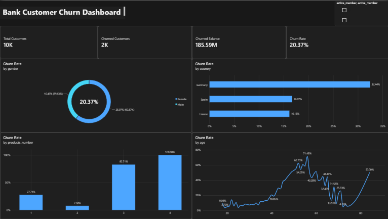

# Bank Customer Churn Analysis & Power BI Dashboard

**Tools:** Power BI · DAX · Power Query · Excel

An end-to-end analysis of 10,000 retail bank customers to find out **who leaves, where, and how much money is affected**, and to turn those patterns into practical retention recommendations.



---

## 1. Problem Statement

Customer churn is a critical challenge for retail banks: every customer who leaves takes their balances, future product sales and referrals with them, and replacing a customer is usually more expensive than keeping one.

The goal of this project is to analyze customer demographic and account patterns to uncover the key drivers behind churn, so that management and marketing teams can design **data-driven retention strategies**.

### Business questions

1. What is the overall churn rate, and how much money is held by customers who left?
2. Which segments (country, gender, age, number of products) churn the most?
3. Where should the bank focus its retention effort first?

---

## 2. Dataset

| Item | Detail |
|---|---|
| Source | Bank Customer Churn dataset on Kaggle: `<add dataset link>` |
| Size | 10,000 customer records |
| Grain | One row per customer (a single snapshot with no time dimension) |
| Fields used | country, gender, age, products_number, active_member, account balance, churn flag |

> The dataset is not included in this repository. Download it from the Kaggle link above and follow its license terms.
> The source does not state the currency of the balance, so monetary values are shown without a currency symbol.

---

## 3. Approach

1. **Data preparation:** cleaned and structured the data using Power Query and Excel.
2. **KPIs and measures:** built DAX measures for total customers, churned customers, churned balance and churn rate, so every chart responds to the same filters.
3. **Dashboard:** one interactive Power BI page with four KPI cards, four churn-rate breakdowns (gender, country, number of products, age) and an `active_member` slicer.
4. **Insights:** translated the patterns into recommendations for the business.

### Measures

| Measure | Definition |
|---|---|
| Total Customers | Number of customers |
| Churned Customers | Number of customers who left |
| Churned Balance | Total balance held by customers who left |
| Churn Rate | Churned customers divided by total customers |

---

## 4. Key Results

| KPI | Value |
|---|---|
| Total customers | 10,000 |
| Churned customers | ≈ 2,037 (shown as 2K on the dashboard) |
| Balance held by churned customers | 185.59M |
| **Overall churn rate** | **20.37%** |

### Key findings

1. **Country: Germany stands out.** Churn is 32.44% in Germany, about double Spain (16.67%) and France (16.15%).
2. **Age: churn rises sharply in middle age.** It stays low for younger customers, starts climbing around age 40, and peaks at 71.43% in the mid-50s. The line becomes unstable at older ages, which likely reflects small group sizes.
3. **Number of products: two is the safest.** Churn is 27.71% with one product and only 7.58% with two. Customers with three or four products show very high churn (82.71% and 100%), but these groups are likely small, so the result needs a closer look before acting on it.
4. **Gender: female customers churn more.** Churn is 25.07% for female customers versus 16.46% for male customers.

> **Reading the gender chart:** the first percentage is each gender's churn rate. The percentage in brackets is that gender's share of the two rates combined, so use the first number for interpretation.

---

## 5. Recommendations

These are based on patterns in the data and should be tested before a full rollout.

1. **Investigate Germany first.** Compare pricing, service quality and competitor activity there to understand why churn is about twice as high.
2. **Move single-product customers to a second product.** Two-product customers churn the least, so a targeted cross-sell offer is a low-risk retention lever.
3. **Review the three- and four-product group.** Check group sizes and whether these customers are over-sold or poorly served before drawing conclusions.
4. **Create a retention program for customers roughly aged 45 to 60,** such as relationship-manager calls or loyalty offers.
5. **Run a short study on female-customer churn** (satisfaction survey or exit feedback) to understand the gap.

---

## 6. Limitations

- The data is a single snapshot, so the analysis shows **association, not causation**.
- Some segments (three to four products, very high ages) contain few customers, which makes their percentages unstable.
- The dataset has no information on customer profitability or acquisition cost, so financial impact is measured only through balances.

---

## 7. Repository Structure

```
bank-churn-analysis/
├── README.md
├── images/
│   └── dashboard.png
└── dashboard/
    └── Bank_Churn_Dashboard.pbix
```

## 8. How to Use

1. Download the dataset from the Kaggle link in section 2.
2. Open `dashboard/Bank_Churn_Dashboard.pbix` in Power BI Desktop.
3. If prompted, point the data source to your local copy of the CSV and click **Refresh**.

## 9. Next Steps

- Group age into bands to remove noise from small groups.
- Add an active vs inactive member comparison to quantify the effect of customer activity.
- Build a predictive churn model in Python to score customers by risk.

---

## Author

**Gehad Khaled Mohamed** · Junior Data Analyst
gehad.khaled.work@gmail.com
